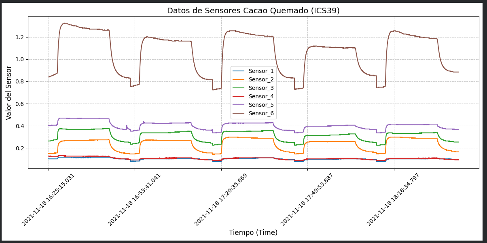

# Cacao Bean Condition Classification

## Overview

This project focuses on processing and analyzing sensor data collected from cacao beans under two conditions: **burned cacao beans (QUEMADO)** and **dried cacao beans (SECO)**.

The workflow combines Excel files containing measurements from six sensors, consolidates the data into CSV files, applies data cleaning and preprocessing techniques, and visualizes sensor behavior over time.

The processed datasets can be used as a foundation for developing machine learning models for cacao bean condition classification.

## Features

- **Data loading:** Reads multiple Excel files from Google Drive.
- **Data integration:** Combines data from multiple files into consolidated CSV datasets.
- **Sensor identification:** Renames the original columns to `Sensor_1` through `Sensor_6`.
- **Data cleaning:** Removes rows containing missing values and duplicate timestamps.
- **Signal smoothing:** Applies a rolling mean filter to reduce short-term fluctuations.
- **Data normalization:** Uses Min-Max normalization to scale sensor measurements to a range between 0 and 1.
- **Data visualization:** Generates plots to compare sensor measurements over time before and after preprocessing.

## Technologies and Libraries

- Python
- Pandas
- NumPy
- Matplotlib
- TensorFlow
- Scikit-learn
- python-calamine
- Google Colab
- Google Drive

## Installation

The project is designed to run in Google Colab.

Install the required libraries:

```python
!pip install python-calamine --upgrade
!pip install matplotlib --upgrade
```

The notebook also imports Pandas, NumPy, TensorFlow, and Scikit-learn. These libraries should be available in the execution environment.

## Dataset Organization

The input Excel files are organized into two folders in Google Drive:

```text
proyecto_cacao/
├── ICS39 QUEMADO/
│   ├── file_1.xlsx
│   ├── file_2.xlsx
│   └── ...
└── ICS39 SECO/
    ├── file_1.xlsx
    ├── file_2.xlsx
    └── ...
```

Each Excel file contains sensor measurements, including a time column and six sensor columns originally named `Untitled`, `Untitled 1`, and so on.

**Note:** The dataset files must be available in the specified Google Drive folders before running the notebook.

## Workflow

### 1. Connect to Google Drive

Mount Google Drive to access the input datasets:

```python
from google.colab import drive
drive.mount('/content/drive')
```

### 2. Load and Merge Excel Files

The `procesar_archivos_cacao()` function reads all `.xlsx` files from a specified folder and combines them into a single CSV file.

The function performs the following operations:

1. Searches for Excel files in the source directory.
2. Reads each file using the `calamine` engine.
3. Uses `openpyxl` as a fallback if the first engine fails.
4. Renames the six sensor columns.
5. Adds an `Archivo_Origen` column to identify the source file.
6. Concatenates the dataframes.
7. Exports the merged dataset to CSV.

Example:

```python
procesar_archivos_cacao(
    '/content/drive/MyDrive/proyecto_cacao/ICS39 QUEMADO',
    './ICS39_QUEMADO_Unido.csv'
)

procesar_archivos_cacao(
    '/content/drive/MyDrive/proyecto_cacao/ICS39 SECO',
    './ICS39_SECO_Unido.csv'
)
```

### 3. Visualize the Original Sensor Data

The `graficar_sensores()` function plots the six sensor signals against time using Matplotlib.

The visualization helps inspect the measurements and compare sensor behavior across the two cacao conditions.

Example:

```python
graficar_sensores(
    './ICS39_QUEMADO_Unido.csv',
    'Burned Cacao Sensor Data (ICS39)'
)

graficar_sensores(
    './ICS39_SECO_Unido.csv',
    'Dried Cacao Sensor Data (ICS39)'
)
```

### 4. Clean, Filter, and Normalize the Data

The `aplicar_filtro_y_normalizar()` function preprocesses the merged datasets.

The preprocessing pipeline includes:

**Missing-value removal**

Rows containing missing values are removed using `dropna()`.

**Duplicate timestamp removal**

Duplicate values in the `Time` column are removed, keeping the first occurrence.

**Rolling mean filter**

A rolling mean with a default window of five samples is applied to the sensor columns to smooth the measurements.

**Min-Max normalization**

The sensor values are scaled using the following formula:

\[
x_{\text{norm}}=\frac{x-x_{\min}}{x_{\max}-x_{\min}}
\]

This transformation maps each sensor's minimum value to 0 and maximum value to 1, provided that the sensor has a nonzero range.

The original timestamps and source-file identifiers are retained in the output when available.

Example:

```python
aplicar_filtro_y_normalizar(
    ruta_entrada='./ICS39_QUEMADO_Unido.csv',
    ruta_salida='./ICS39_QUEMADO_Filtrado_Ventana.csv',
    ventana=5
)

aplicar_filtro_y_normalizar(
    ruta_entrada='./ICS39_SECO_Unido.csv',
    ruta_salida='./ICS39_SECO_Filtrado_Ventana.csv',
    ventana=5
)
```

### 5. Visualize the Processed Data

After preprocessing, the sensor signals are plotted again to evaluate the effect of smoothing and normalization.

The resulting plots allow comparison of the original and processed signals for burned and dried cacao beans.

## Output Files

The notebook generates four CSV files:

| File | Description |
|---|---|
| `ICS39_QUEMADO_Unido.csv` | Merged sensor data for burned cacao beans. |
| `ICS39_SECO_Unido.csv` | Merged sensor data for dried cacao beans. |
| `ICS39_QUEMADO_Filtrado_Ventana.csv` | Cleaned, smoothed, and normalized burned cacao data. |
| `ICS39_SECO_Filtrado_Ventana.csv` | Cleaned, smoothed, and normalized dried cacao data. |

## Dataset Summary

Based on the reported execution results:

| Dataset | Original rows | Processed rows |
|---|---:|---:|
| Burned cacao (QUEMADO) | 4,750 | 4,750 |
| Dried cacao (SECO) | 5,700 | 5,700 |

In this execution, the number of rows remained unchanged after preprocessing.

## How to Run the Project

1. Open the notebook in Google Colab.
2. Install the required dependencies.
3. Mount Google Drive.
4. Place the Excel files in the expected input folders.
5. Run the data merging functions.
6. Generate plots of the original sensor measurements.
7. Apply cleaning, filtering, and normalization.
8. Generate plots of the processed datasets.

## Notes and Limitations

- The input data must contain a `Time` column and the expected sensor columns.
- The current workflow uses a rolling window of five samples.
- Duplicate timestamps are removed independently within each merged dataset.
- Min-Max normalization is performed separately for each dataset and sensor.
- The current code performs data preprocessing and visualization; it does not yet train or evaluate a classification model.
- The notebook uses Google Colab-specific functionality to access Google Drive.

## Future Work

Potential extensions include:

- Feature extraction from sensor signals.
- Exploratory data analysis and statistical comparison.
- Development of machine learning models for cacao condition classification.
- Model evaluation using appropriate classification metrics.
- Deployment of a trained model for automated cacao quality assessment.

### Burned Cacao Sensor Measurements

The following figure shows the measurements collected from the six sensors during the analysis of burned cacao beans (ICS39). The signals are plotted over time to observe their behavior and identify variations in sensor responses.



**Figure 1.** Sensor measurements for burned cacao beans (ICS39).

## Author

**Angie Castano**

